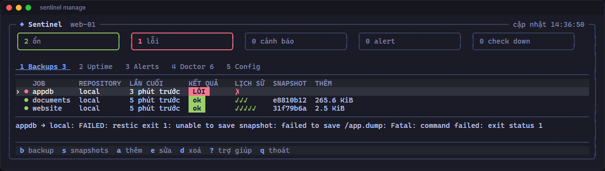
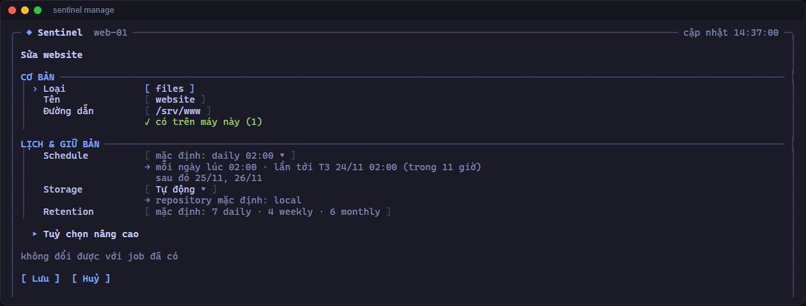

# Sentinel

Một binary Go cài trên mỗi server Linux: **backup** file và database bằng restic, **kiểm tra uptime**, và **cảnh báo** khi có chuyện. Điều khiển bằng dòng lệnh, file cấu hình YAML và một màn hình quản lý trong terminal.



- **Backup** PostgreSQL, MySQL/MariaDB, MongoDB và file/thư mục bằng [restic](https://restic.net) (mã hóa, chống trùng lặp, snapshot) lên thư mục, S3 (AWS, MinIO, R2, Wasabi…), sftp hoặc Google Drive (qua [rclone](https://rclone.org)); có retention và `restic check` định kỳ.
- **Uptime** HTTP (status, từ khóa, hạn chứng chỉ TLS), TCP, ping.
- **Cảnh báo** qua Telegram, Email (SMTP), Discord, Slack: báo khi lỗi, nhắc lại theo `cooldown`, báo khi đã khắc phục, và báo khi một job quá lâu chưa backup thành công.

Sentinel không có web UI, không có server trung tâm và không đo CPU/RAM/disk (dùng công cụ giám sát riêng cho việc đó). Phiên bản hiện tại: v0.1.0.

## Cài đặt

**Trên server Ubuntu/Debian** (cần root). Một dòng lệnh cài Sentinel cùng restic, rclone, `pg_dump`, `mariadb-dump`, `mongodump`, rồi tạo `/etc/sentinel/config.yaml`, `/etc/sentinel/sentinel.env` và systemd unit:

```sh
curl -fsSL https://raw.githubusercontent.com/VoDinhViet/sentinel/main/deploy/install.sh | sudo sh
```

Mọi thứ tải về (Sentinel, restic, rclone, mongodump) đều được kiểm tra SHA-256 trước khi cài, và chỉ tải qua `https://` (`SENTINEL_BASE_URL` cũng phải là `https://`). Chạy lại đúng lệnh này để nâng cấp (`config.yaml` và `sentinel.env` được giữ nguyên). Thêm sau `sh -s --`: `--version v0.1.0` để cài đúng một bản, `--no-mongo` bỏ `mongodump`, `--no-db-clients` bỏ client PostgreSQL/MariaDB. Client PostgreSQL phải cùng major version với server (`sentinel doctor` báo khi thiếu).

Sau khi cài: sửa `/etc/sentinel/config.yaml` và `sentinel.env`, rồi

```sh
sentinel doctor                      # kiểm tra config, công cụ, kho backup
sentinel backup init appdb           # tạo kho restic (một lần cho mỗi job)
sudo systemctl enable --now sentinel
```

**Trên máy của bạn** (không cần root, không cần service). Cần Go hoặc docker để build:

```sh
make build && make install           # cài vào ~/.local/bin
sentinel init                        # một form: lưu ở đâu, backup gì, lịch nào, và (tuỳ chọn) kênh cảnh báo Telegram, Discord hoặc Slack -> ~/.config/sentinel/config.yaml
sentinel backup run documents        # backup ngay
sentinel manage                      # màn hình quản lý
```

Gõ `sentinel` trơn trên terminal thì mở `init` nếu chưa có config, đã có thì mở `sentinel manage`. Config được lấy theo thứ tự: `--config`, biến `SENTINEL_CONFIG`, `/etc/sentinel/config.yaml`, `~/.config/sentinel/config.yaml`.

## Cấu hình

Mẫu đầy đủ, có chú thích từng trường: [deploy/config.example.yaml](deploy/config.example.yaml) (server) và [deploy/config.user.example.yaml](deploy/config.user.example.yaml) (máy cá nhân).

Mật khẩu và token không viết thẳng vào config mà viết dạng `${TÊN_BIẾN}`; giá trị thật nằm trong `/etc/sentinel/sentinel.env` (quyền 0600):

```sh
RESTIC_PASSWORD=mot-mat-khau-dai-va-ngau-nhien
AWS_ACCESS_KEY_ID=...
AWS_SECRET_ACCESS_KEY=...
TG_TOKEN=123456:ABC...
```

> **Mất `RESTIC_PASSWORD` là mất toàn bộ backup.** Hãy lưu nó ở nơi khác ngoài server.

Trên terminal, nếu thiếu một biến, Sentinel hỏi giá trị bằng ô nhập ẩn và có thể lưu vào `sentinel.env`. Daemon và script không bao giờ hỏi: thiếu biến là lỗi.

### Lịch chạy

| Viết | Nghĩa |
|---|---|
| `daily 02:00` | mỗi ngày lúc 02:00 |
| `weekly sun 03:00` | mỗi Chủ nhật lúc 03:00 |
| `monthly 1 04:00` | ngày 1 hằng tháng lúc 04:00 |
| `hourly`, `hourly :15` | đầu mỗi giờ, hoặc phút 15 mỗi giờ |
| `every 6h` | mỗi 6 giờ (tối thiểu 1m) |
| `manual` hoặc để trống | chỉ chạy tay |

Cron 5 trường (`"0 2 * * *"`) vẫn dùng được. Khối `defaults:` đặt sẵn `schedule`, `repositories`, `retention` cho các job không ghi riêng:

```yaml
defaults:
  schedule: daily 02:00
  repositories: [s3main, gdrive]
  retention: { daily: 7, weekly: 4, monthly: 6 }
```

### Google Drive

Chạy bằng root (vì service chạy bằng root):

```sh
sudo rclone config     # n) New remote -> name: gdrive -> storage: drive -> scope: drive.file
sudo rclone lsd gdrive:
```

Server không có trình duyệt: ở bước auto config chọn `n` rồi làm theo `rclone authorize "drive"` trên máy có trình duyệt. Sau đó dùng `url: "rclone:gdrive:backups/<server>"` trong `repositories`.

### Telegram

Tạo bot với @BotFather để lấy token, thêm bot vào nhóm, gửi một tin nhắn rồi mở `https://api.telegram.org/bot<TOKEN>/getUpdates` để lấy `chat.id`. Thử bằng `sentinel notify test`.

## Các lệnh hay dùng

```sh
sentinel doctor                      # kiểm tra config, restic/rclone/pg_dump, kho, nơi lưu trạng thái
sentinel backup run appdb            # chạy backup ngay
sentinel backup list appdb           # liệt kê snapshot
sentinel backup restore appdb latest --target /tmp/restore [-r s3main]
sentinel check                       # chạy mọi uptime check một lần
sentinel status                      # backup gần nhất, cảnh báo đang mở, uptime
sentinel status -o json              # như trên, cho script
sentinel notify test                 # gửi tin thử tới mọi kênh cảnh báo
journalctl -u sentinel -f            # log của daemon
```

Chạy tay ngoài systemd thì nạp biến trước: `set -a; . /etc/sentinel/sentinel.env; set +a`.

## Khôi phục dữ liệu

`sentinel backup restore` đưa snapshot ra thư mục `--target`, rồi in lệnh để nạp lại vào database:

```sh
# PostgreSQL: file <database>.dump
pg_restore --clean --if-exists -d app /tmp/restore/app.dump

# MySQL/MariaDB: file <database>.sql
mysql shop < /tmp/restore/shop.sql

# MongoDB: file <database>.archive.gz
mongorestore --drop --gzip --archive=/tmp/restore/crm.archive.gz --nsInclude 'crm.*'
```

Job `files` thì file nằm ngay trong `--target`.

`--target` phải là đường dẫn tuyệt đối. Thư mục chưa có sẽ được tạo với quyền `0700`; thư mục có sẵn phải thuộc user đang chạy, không phải symlink và không cho group hoặc người khác ghi, vì restic ghi qua bất cứ thứ gì nó thấy ở đó với quyền của user này (thường là root). Đích là `/` hoặc thư mục hệ thống (`/etc`, `/var`, `/home`, thư mục dữ liệu database...) bị từ chối trừ khi thêm `--force`; `--force` cũng bỏ kiểm tra chủ sở hữu và quyền của thư mục đích, cho mount NFS/CIFS hay thư mục của user khác khi chạy qua `sudo`.

## Màn hình quản lý

`sentinel manage` mở trong terminal với năm tab (phím `1`-`5`): **Backups**, **Uptime**, **Alerts**, **Doctor**, **Config**. Dòng tóm tắt trên cùng cho biết cần chú ý gì, cột LỊCH SỬ là các lần chạy gần nhất của job (`✓✓✗✓`, mới nhất ở bên phải). Màn hình tự làm mới mỗi 5 giây; chuột dùng được cho mọi thứ (trong `tmux` cần `set -g mouse on`); bấm `?` để xem các phím của màn hình đang mở.

| Phím | Việc |
|---|---|
| `b` | backup ngay job đang chọn (không chạy chồng với daemon) |
| `s` | xem snapshot của job và restore |
| `a` `e` `d` | thêm, sửa, xóa job, kho, uptime check, kênh cảnh báo trong `config.yaml` |
| `t` | (tab Config, dòng Notifier) gửi tin thử qua kênh đó; đọc kênh từ file config nên không cần khởi động lại, và chỉ cần các biến của chính kênh đó |
| `ctrl+t` | (trong form job database) thử kết nối: chạy đúng công cụ dump với host, cổng, user, mật khẩu của form rồi dừng ngay khi nó bắt đầu ghi (chỉ đọc), hiện `✓ kết nối được` hoặc lý do lỗi của công cụ; cũng là nút `[ Kết nối thử ]` dưới ô mật khẩu |
| `r` | làm mới / chạy lại Doctor |



Form sửa giữ nguyên comment và thứ tự trong `config.yaml`; bản cũ được lưu thành `config.yaml.bak`. Mật khẩu và token không nhập ở đây, chỉ nhập *tên* biến môi trường. Sửa xong, daemon đang chạy cần `systemctl restart sentinel` để nhận thay đổi.

## Chạy bằng Docker

`make docker` build image `sentinel:latest` (đã gồm restic, rclone, pg_dump), rồi dùng [deploy/docker-compose.yml](deploy/docker-compose.yml). Mount các đường dẫn cần backup (chỉ đọc) vào đúng đường dẫn trong config; `network_mode: host` để uptime check và `pg_dump` tới được dịch vụ trên server.

### Font và locale khi chạy trên VPS

Màn hình `sentinel manage` có chữ tiếng Việt và vẽ khung, nên cần hai thứ, cả hai nằm ngoài Sentinel:

- **Font của terminal phía máy bạn** (nơi mở SSH) phải có chữ Việt. Font như `MesloLGS NF` thiếu nhiều chữ có dấu (ả, ấ, ầ, ố, ế, ỗ...), nên "lỗi", "cảnh báo" chỉ còn dấu. Dùng `JetBrains Mono` hoặc `Cascadia Mono`. Trong VS Code: `"terminal.integrated.fontFamily": "JetBrains Mono, MesloLGS NF, monospace"`, để font Nerd phía sau chỉ lo icon.
- **Locale UTF-8 trên server.** Nhiều image VPS để locale `POSIX`. Chạy `export LANG=C.UTF-8` (thêm vào `~/.profile`). Trong `tmux` thêm `-u`. `sentinel doctor` cảnh báo `locale` khi locale không phải UTF-8.

## Lưu ý

- Kho từ xa (S3, sftp, rclone) phải tạo bằng `sentinel backup init <job>` một lần. Kho là thư mục trên chính máy này thì tự tạo ở lần backup đầu, nếu thư mục chưa có hoặc đang trống.
- Nếu `pg_dump` thất bại thì restic không tạo snapshot và lần chạy được ghi là lỗi. Backup có snapshot nhưng không đọc được một số file cũng tính là lỗi.
- Job có nhiều repository thì mỗi repository được backup riêng.
- Khi repository đang bị khóa, daemon thử lại 3 lần, cách nhau 5 phút. Sentinel không bao giờ tự `unlock`.
- Daemon khởi động lại thì không gửi lại các cảnh báo đang mở, nhưng vẫn báo khi chúng được khắc phục.
- Lịch sử uptime giữ 30 ngày; lịch sử backup giữ vĩnh viễn.
- MariaDB client ≥ 11.4 mặc định đòi TLS; server không có TLS thì đặt `tls: disabled` trong khối `mysql:`.

## Phát triển

```sh
make test         # golangci-lint + govulncheck + go vet + go test
make e2e          # Postgres + S3 bằng docker
make e2e-engines  # MariaDB, MySQL, MongoDB bằng docker
```
